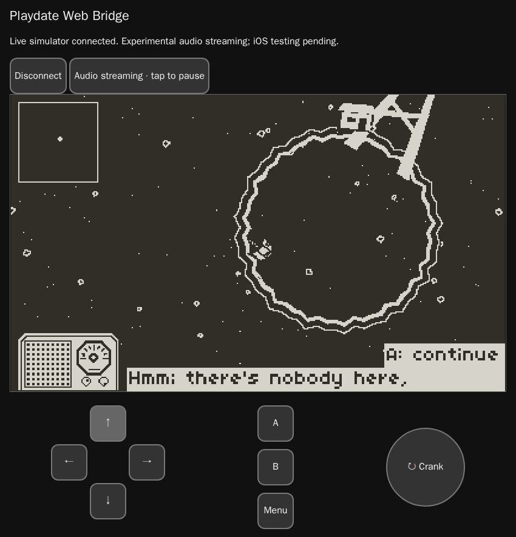

# Playdate Web Bridge

Run the Playdate simulator on a Linux host and play remotely from your browser, with touch controls, a virtual crank, live video, and audio.



*[Starfield for Playdate](https://github.com/NickTitle/starfield-playdate), played through the bridge.*

## Quick start

On the Linux host, install Xvfb/X11, Go 1.22+, Make, a C compiler, and the [Playdate SDK](https://play.date/dev/). Copy your simulator-compatible `.pdx` game there.

```sh
git clone https://github.com/NickTitle/playdate-web-bridge.git
cd playdate-web-bridge
make build audio
```

Choose how your browser will reach the host:

| Connection | Example browser origin | Setup |
| --- | --- | --- |
| SSH forwarding | `http://localhost:8080` | [SSH tunnel](docs/usage.md#ssh-forwarding) |
| Tailscale Serve | `https://your-host.your-tailnet.ts.net` | [Tailscale HTTPS](docs/usage.md#tailscale-https) |
| Your reverse proxy or VPN | `https://playdate.example.com` | [Other connections](docs/usage.md#reverse-proxy-or-private-network) |

On the host, set `BRIDGE_ORIGIN` to your chosen browser origin—for example, `export BRIDGE_ORIGIN=http://localhost:8080` for SSH forwarding. Then launch:

```sh
export PLAYDATE_SDK_PATH=/path/to/PlaydateSDK
./build/playdate-web-bridge \
  -cartridge /path/to/MyGame.pdx \
  -session "$PWD/session" \
  -origin "$BRIDGE_ORIGIN" \
  -audio-library "$PWD/build/audio_stream.so"
```

On your client, establish the chosen connection and open its browser address. Tap **Connect**, then **Enable audio**. The D-pad is left, B/A right, Menu upper right, with a separate crank dial. Keep the host command running while you play.

[Remote usage](docs/usage.md) · [How does it work?](docs/how-it-works.md) · [Development](docs/development.md) · [License](LICENSE) · [Dependencies](docs/third-party.md)
